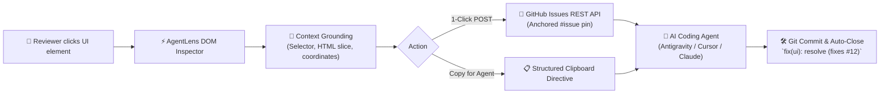

# ⚡ AgentLens

> **Visual DOM feedback & issue tracker built for AI coding agents.**  
> Turn live UI clicks into pixel-grounded GitHub Issues and zero-ambiguity prompts for Claude, Cursor, Antigravity, and Copilot.

[](LICENSE)
[]()
[]()

---

## 🎯 Why AgentLens?

When human designers, PMs, or users review web applications, feedback is usually ambiguous:
> *"The blue button on the right is misaligned and the card description is outdated."*

AI coding agents struggle with vague prompts. They need **precise DOM coordinates, CSS selectors, target file paths, and exact text snippets**.

**AgentLens bridges this gap.** It embeds a lightweight floating dock into your web application. Clicking any element (or pressing <kbd>C</kbd>) inspects the DOM, captures its exact context, and lets you:
1. **File a GitHub Issue directly from the page** via GitHub's REST API (zero redirects or reloads).
2. **Copy a zero-ambiguity Markdown directive** directly into your AI coding agent's chat window.
3. **Anchor visual pin badges (`#issue`)** directly onto elements across page reloads.



---

## ✨ Features

- **🎯 Precision DOM Targeting**: Hover over any element to view live tag/class tooltips; click to anchor an issue popover.
- **⚡ Zero Redirection**: Issues are posted directly using GitHub's REST API without leaving the app.
- **🛡️ Secure RBAC Authentication**: Validates GitHub Personal Access Tokens (PATs) and checks repo permissions (`Admin`, `Maintainer`, `Write`). Tokens stay safely in client `localStorage`.
- **📌 Persistent Pin Badges**: Filed issues stick to their DOM elements as `#issue` badges even after page reloads.
- **🤖 Agent-First Directives**: Generates markdown containing file path, CSS selector, clean outer HTML, and element text.
- **📦 Zero External Dependencies**: No Tailwind, Bootstrap, or FontAwesome required. Fully self-contained with inline SVG icons.
- **⌨️ Keyboard Shortcuts**: Press <kbd>C</kbd> to inspect and pin; press <kbd>Esc</kbd> to dismiss; press <kbd>Cmd</kbd>+<kbd>Shift</kbd>+<kbd>F</kbd> to connect GitHub.

---

## 🚀 1-Minute Quickstart

### Option 1: Drop-in via CDN (Fastest)

Add this single `<script>` tag before the closing `</body>` or in `<head>`:

```html
<script 
  src="https://cdn.jsdelivr.net/gh/fredhersch/agent-lens@main/dist/agent-lens.min.js"
  data-repo="your-username/your-repository"
  data-position="bottom-right"
  defer>
</script>
```

Replace `your-username/your-repository` with your GitHub repository.

---

### Option 2: Self-Hosted Static Script

1. Copy `dist/agent-lens.js` or `dist/agent-lens.min.js` to your project's assets folder (e.g. `public/js/` or `assets/js/`).
2. Add the script tag to your HTML templates:

```html
<script 
  src="/assets/js/agent-lens.min.js" 
  data-repo="my-org/my-app"
  defer>
</script>
```

---

### Option 3: Next.js / React Integration

In your root layout or `App.tsx`:

```tsx
import Script from 'next/script';

export default function RootLayout({ children }: { children: React.ReactNode }) {
  return (
    <html lang="en">
      <body>
        {children}
        {process.env.NODE_ENV !== 'production' && (
          <Script
            src="https://cdn.jsdelivr.net/gh/fredhersch/agent-lens@main/dist/agent-lens.min.js"
            data-repo="my-org/my-app"
            data-position="bottom-right"
            strategy="lazyOnload"
          />
        )}
      </body>
    </html>
  );
}
```

---

## ⚙️ Configuration Options

You can configure AgentLens either via HTML `data-*` attributes or programmatically:

### HTML Attributes

| Attribute | Type | Default | Description |
| :--- | :--- | :--- | :--- |
| `data-repo` | `string` | `""` | Target GitHub repository (`owner/repo`). If omitted, user is prompted in the modal. |
| `data-position` | `string` | `"bottom-right"` | Dock position: `"bottom-right"`, `"bottom-left"`, `"top-right"`, `"top-left"`. |
| `data-labels` | `string` | `"agent-task,ui-feedback"` | Comma-separated labels applied to created GitHub issues. |
| `data-theme` | `string` | `"dark"` | UI theme (`"dark"` or `"light"`). |

### Programmatic Setup

```javascript
window.AgentLensConfig = {
  repo: 'my-org/my-app',
  position: 'bottom-right',
  defaultLabels: ['agent-task', 'ui-feedback', 'staging']
};
```

Or initialize manually:

```javascript
import AgentLens from 'agent-lens';

AgentLens.init({
  repo: 'my-org/my-app',
  position: 'bottom-left'
});
```

---

## 🔐 GitHub Authentication & Permissions

1. Click **Connect** on the floating dock (or press <kbd>Cmd</kbd>+<kbd>Shift</kbd>+<kbd>F</kbd>).
2. Enter a GitHub **Personal Access Token (PAT)**:
   - **Fine-grained PAT**: Needs `Issues: Read and Write` on the target repository.
   - **Classic PAT**: Needs `repo` scope.
   - [Generate a Token on GitHub ↗](https://github.com/settings/tokens/new?scopes=repo&description=AgentLens+Widget)
3. AgentLens immediately validates token authenticity and verifies user role (`Admin`, `Maintainer`, or `Write`).
4. Tokens are stored strictly in the browser's `localStorage` — **never sent to third-party telemetry servers**.

---

## 🤖 The AI Agent Loop (Cursor / Claude / Antigravity)

AgentLens comes with companion CLI tools and agent skills so coding assistants can resolve issues automatically:

### 1. Fetch & Parse Issues via CLI

```bash
# Pull and parse all open AgentLens issues
python3 cli/fetch_issues.py --repo my-org/my-app
```

Output:
```markdown
# 🎯 AgentLens Issues for `my-org/my-app` (2 total)

| # | Category | Target File | Element Selector / Text | Directive | Link |
|---|----------|-------------|-------------------------|-----------|------|
| **#14** | `UI Fix` | `index.html` | `#hero-btn` | Make button pill-shaped and blue | [View](#) |

### 📄 `index.html` (1 task)
- **Issue #14** (UI Fix): Make button pill-shaped and blue
  - **Selector**: `#hero-btn`
  - **Element Text**: `Get Started Today`
  - **Snippet**: `<button id="hero-btn" class="btn">Get Started Today</button>`
```

### 2. Instruct Your AI Agent

Simply instruct your AI agent (in Claude Code, Cursor, or Antigravity):
> *"Run `python3 cli/fetch_issues.py --repo my-org/my-app` and implement the requested changes."*

Because the selector and text snippet are exact, the agent can locate the file and lines with zero ambiguity using `git grep`.

### 3. Auto-Close Resolved Issues

Commit using standard GitHub closing keywords:
```bash
git commit -m "fix(ui): make hero button pill-shaped (fixes #14)"
git push origin main
```
GitHub will automatically close the issue and resolve the pin!

---

## 📁 Repository Structure

```
agent-lens/
├── README.md               # Documentation & deployment guide
├── LICENSE                 # MIT License
├── package.json            # npm package & script configuration
├── dist/
│   ├── agent-lens.js       # Standalone unminified distribution
│   └── agent-lens.min.js   # Production minified bundle (~14KB)
├── src/
│   └── agent-lens.js       # Core source code with zero-dependency SVGs
├── demo/
│   └── index.html          # Interactive playground & demo sandbox
├── cli/
│   ├── fetch_issues.py     # Python CLI issue fetcher & DOM directive parser
│   └── agentlens_cli.js    # Node.js CLI alternative
└── skills/
    ├── antigravity/        # Google Antigravity skill (SKILL.md)
    ├── cursor/             # Cursor rules snippet (.cursorrules)
    └── claude/             # Claude Code workflow guide (CLAUDE.md)
```

---

## 🧪 Testing the Demo Locally

To test the interactive demo right away:

```bash
# Using Python
python3 -m http.server 8000

# Or using Node.js npx
npx serve .
```

Open `http://localhost:8000/demo/` in your browser and press <kbd>C</kbd> to start pinning directives!

---

## 📄 License

[MIT](LICENSE) © 2026 Fred Hersch
